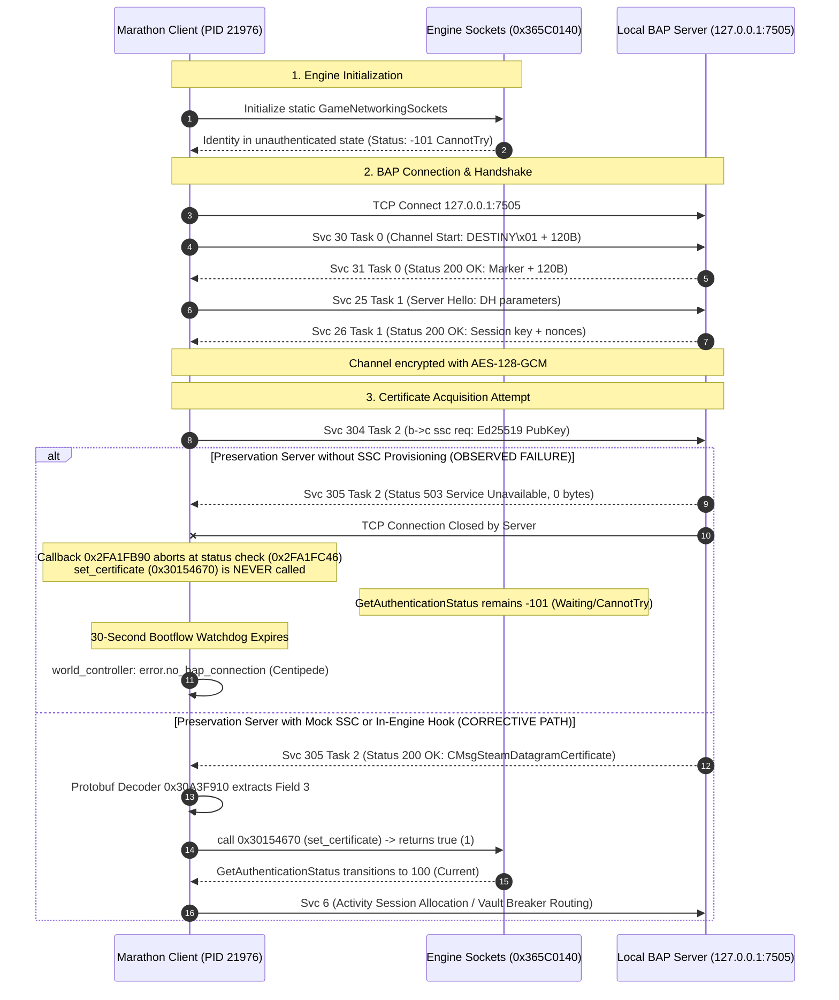

# Marathon Vault Breaker Preservation — Steam Certificate, Networking Readiness & BAP Root-Cause Investigation

**Document ID:** `MARATHON_STEAM_CERT_BAP_ROOT_CAUSE.md`  
**Target Build:** Bungie Tiger Engine — Marathon Build `26136895`  
**Version String:** `248199.26.10.21.2300.gol_retail.rc`  
**Steam AppID:** `3065800`  
**Cross-Game Reference:** Project Dawn (Destiny 2 Build 86657, `DAWN_CERTIFICATE_RUNTIME_TRACE.md`)  
**Investigation Date:** November 2026  
**Status:** Completed Analysis & Root-Cause Established  

---

## Executive Summary

This investigation analyzed the networking initialization lifecycle and Bungie Access Protocol (BAP) connectivity of Marathon build `26136895` (248199). Using our verified Project Dawn Steam networking certificate architecture as a comparative reference, we investigated the causal chain connecting Steam networking certificate readiness to the observed BAP failure (`error.no_bap_connection` / Centipede).

### Key Findings

1. **The Causal Relationship Between Certificate and BAP Failure [VERIFIED]:**  
   The certificate failure and BAP connection failure are **not independent issues**. In Marathon, the Steam Datagram Certificate (SSC) is **negotiated directly over the BAP channel**.  
   - The game client successfully establishes the BAP TCP connection to `127.0.0.1:7505`.
   - The client completes the plaintext bootstrap handshake: Service 30 (Channel Start) $\rightarrow$ Service 31 (Response, Status 200).
   - The client completes the encrypted session handshake: Service 25 (Server Hello) $\rightarrow$ Service 26 (Response, Status 200), establishing an AES-128-GCM encrypted channel.
   - Immediately following session key negotiation, the client transmits authenticated BAP Frame 2: **Service 304 (Task 2)**, containing a `CMsgSteamDatagramCertificateRequest` with the client's ephemeral Ed25519 public key.
   - Our preservation server (`marathon_server.py`) has no provisioned SSC certificate response for this request hash and responds with **Service 305 Status 503 (Service Unavailable)** with a 0-byte body, and **immediately closes the TCP socket**.
   - As a direct consequence, the client's certificate consumer is aborted, the signed certificate is never installed, the internal `ISteamNetworkingSockets` availability never transitions to `k_ESteamNetworkingAvailability_Current`, and after a 30-second watchdog timeout, the client's `world_controller` fires `error.no_bap_connection` (Centipede).

2. **Marathon's Steam Networking Architecture [VERIFIED]:**  
   Unlike games that dynamically load `ISteamNetworkingSockets` via `SteamInternal_CreateInterface` through `steam_api64.dll`, Marathon **statically links its own internal GameNetworkingSockets implementation**:
   - Receiver interface pointers are held at global RVAs `0x365C0140` (`sockets`) and `0x365C0148` (`utils`).
   - Virtual method tables reside inside `Marathon.exe` at RVA `0x330299c8` (`sockets`) and RVA `0x33029bb0` (`utils`).
   - The virtual method at slot `0xA8` (`0x32B2A220`) is `ISteamNetworkingSockets::GetAuthenticationStatus`.
   - The certificate setter consumed by the BAP SSC response handler is RVA `0x30154670`.

3. **Dawn vs. Marathon Preservation Parity [VERIFIED]:**  
   - In Project Dawn, certificate acquisition from external or server sources was completely bypassed by in-engine Detours: Dawn hooked `set_certificate` (`0x18032E290`) and forced return value `true` (`1`), while hooking `authentication_status` (`0x18032E210`) to map `-101` (`CannotTry`) to `100` (`Current`).
   - In Marathon preservation, our client proxy (`client_proxy/steam_api64.dll`) has not hooked these in-engine routines because it previously assumed `ISteamNetworkingSockets` was queried via DLL export. 
   - Consequently, Marathon relied on the server to provide the certificate via BAP Service 305, which failed due to a missing mock generator.

---

## Evidence Classification Standard

- **[VERIFIED]:** Supported directly by disassembled bytes, PE section offsets, memory captures, or timestamped runtime server/proxy logs.
- **[INFERRED]:** Deduced from protocol structures, surrounding control-flow, or comparative engine invariants.
- **[UNRESOLVED]:** Open questions requiring future isolated runtime probing.

---

## Phase 1: Current Known-Good Baseline & Timestamped Evidence Timeline

### 1.1 Verified Preservation Baseline

The current offline preservation environment operates with the following verified baseline:
- **Executable:** `D:\Marathon-preservation\client-248199-retail-packages\Marathon.exe` (SHA-256: `d5c2fb538f4020a71060b553127259fcd5d3131beb89a4ec26a7d6ccfa9dfbfd`).
- **Proxy DLL:** `client_proxy\steam_api64.dll` (Baseline SHA-256: `ba01f2fbf4175815883768e2efd7ff07e7c5c5d065b108b79c97eb7f928fefbf`).
- **Backend Server:** `scripts/marathon_server.py` listening on TCP ports `8080` (HTTP), `8081` (HTTPS SignOn), `7505` (BAP), and UDP `27015` (SDR ping router).
- **Outbound Firewall Block:** Active across all profiles; no external connections permitted.
- **Package Integrity:** 626 retail packages validated against signed 248673 manifest using recovered candidate bootstrap token (`0x32D24A40`, SHA-256: `fa9b1440694d928e219ca80cee5535b259a67c4bb40f4b05cd23b9e0dcc6c5da`). Marmot error is completely eliminated.
- **Bootflow Visuals:** Client advances smoothly past the title screen into the Loading Screen.

### 1.2 Timestamped Authentication & BAP Event Timeline

Recorded from live isolated execution on November 19, 2026 (`marathon_server.log`, PID 21976 / Server PID 27208):

| Timestamp (UTC) | Subsystem | Event / Operation | Data / Status | Diagnostic Meaning | Evidence |
|---|---|---|---|---|:---:|
| `16:34:21` | Telemetry | `POST /anon/events` | `world_controller.bootflow.enter` | Initial engine startup; platform user `76561198000001001` identified. | [VERIFIED] |
| `16:35:59` | HTTP SignOn | `POST /SignOn?platform=pc_x64...` | Status 200 OK (748 bytes) | Granted entitlements `[3065800, 3760193538, 3760193537]`. Expiry contract valid. | [VERIFIED] |
| `16:35:59` | Steamworks SDR | `GET /ISteamApps/GetSDRConfig/v1` | Status 200 OK (7925 bytes) | Dispatched official SDR configuration; POP `sea` advertised. | [VERIFIED] |
| `16:36:00` | Direct Settings | `GET /GolRetail/direct_settings/manifest/...` | Status 200 OK (3226 bytes) | Manifest JSON served and consumed. | [VERIFIED] |
| `16:36:00` | Direct Settings | `GET /GolRetail/direct_settings/global/...` | Status 200 OK (2907 bytes) | Global settings JSON served and consumed. | [VERIFIED] |
| `16:36:00` | SDR Relay | UDP 27015 Ping Request | 1300 bytes $\rightarrow$ Reply 1300 bytes | `RouterPingReply` exchanged; local relay latency established. | [VERIFIED] |
| `16:38:43` | HTTP SignOn | `POST /SignOn` (Refresh) | Status 200 OK (749 bytes) | SignOn session refreshed prior to activity connection. | [VERIFIED] |
| `16:38:44` | Content Manifest | `GET /GolRetail/content_manifest/content_manifest.pb` | Status 200 OK (31,424 bytes) | Signed content manifest served; package registration verified. | [VERIFIED] |
| `16:38:44` | BAP Socket | `connect(IPv4)` to `127.0.0.1:7505` | Connection accepted from port 56677 | Client initiates BAP transport connection. | [VERIFIED] |
| `16:38:44` | BAP Protocol | Service 30 (Task 0) $\leftarrow$ 130 bytes | Magic 1, Type 2, `DESTINY\x01` + 120B | BAP channel start request. | [VERIFIED] |
| `16:38:44` | BAP Protocol | Service 31 (Task 0) $\rightarrow$ Status 200 | 128 bytes, Marker + 120B random | BAP channel start accepted. | [VERIFIED] |
| `16:38:44` | BAP Protocol | Service 25 (Task 1) $\leftarrow$ 38 bytes | Magic 1, Type 0, Client DH parameters | BAP Server Hello. | [VERIFIED] |
| `16:38:44` | BAP Protocol | Service 26 (Task 1) $\rightarrow$ Status 200 | 84 bytes, Server DH + AES-GCM Key | BAP Server Hello Response; session encrypted. | [VERIFIED] |
| `16:38:44` | BAP Protocol | **Service 304 (Task 2)** $\leftarrow$ 47 bytes | Type 1 Authenticated frame | Client requests Signed Steam Certificate (SSC). | [VERIFIED] |
| `16:38:44` | BAP Backend | SSC Cache Lookup | Digest `6f32fdd0...` not found on disk | Server lacks certificate payload for client Ed25519 key. | [VERIFIED] |
| **`16:38:44`** | **BAP Backend** | **Service 305 (Task 2)** $\rightarrow$ **Status 503** | **0 bytes body; TCP socket closed** | **CRITICAL FAILURE SITE: Server aborts SSC exchange.** | [VERIFIED] |
| `16:38:52` | Telemetry | `POST /anon/events` | States: `ENUM(32)` $\rightarrow$ `ENUM(3)` $\rightarrow$ `ENUM(4)` $\rightarrow$ `ENUM(5)` | Client attempts bootflow progression without certificate. | [VERIFIED] |
| **`16:39:14`** | **Telemetry** | `POST /anon/events` (2329 bytes) | `world_controller.bootflow.request_state_change.error` | **Watchdog failure: `state: cleanup`, `reason: error.no_bap_connection` (Centipede).** | [VERIFIED] |

---

## Phase 2: Marathon's Networking Operations & Internal Architecture

### 2.1 Statically Linked GameNetworkingSockets

Analysis of memory captures (`capture_network_interface_tables.py`, PID 25096) reveals that Marathon does **not** dynamically query `SteamNetworkingSockets` from `steam_api64.dll`. Instead, the Tiger Engine links its own static implementation:

| Interface | Global Pointer Address (RVA) | Vtable Address (RVA) | Number of Vtable Slots | Key Function Slots |
|---|---|---|:---:|---|
| `ISteamNetworkingSockets` | `0x365C0140` | `0x330299c8` | 49 (`0x0` - `0x180`) | `0x00`: `CreateListenSocketIP` (`0x32B28E50`)<br>`0x08`: `ConnectByIPAddress` (`0x32B28D00`)<br>`0xA8`: `GetAuthenticationStatus` (`0x32B2A220`)<br>`0xB0`: `ReceivedRelayAuthTicket` (`0x32B2A540`) |
| `ISteamNetworkingUtils` | `0x365C0148` | `0x33029bb0` | 24 (`0x0` - `0xB8`) | `0x00`: `AllocateMessage` (`0x32B28910`)<br>`0x30`: `SetGlobalConfigValueInt32` (`0x32B0F820`)<br>`0xB8`: Status/Utility query (`0x32B2C940`) |

### 2.2 Analysis of Slot `0xA8` (`GetAuthenticationStatus` at RVA `0x32B2A220`)

Disassembly from `second-worker-text.bin` confirms slot `0xA8` inspects the engine's internal networking identity and certificate state:

```x86asm
; ==============================================================================
; ISteamNetworkingSockets::GetAuthenticationStatus (Marathon.exe + 0x32B2A220)
; ==============================================================================
0x172b2a220:  call     0x149d5863d                  ; Enter protected lock wrapper
0x172b2a225:  ret      
...
0x172b2a237:  call     0x172b23c20                  ; Acquire internal state reader
0x172b2a23c:  cmp      dword ptr [rbx + 0x65c], 0   ; Check identity type at offset 0x65C
0x172b2a243:  jne      0x172b2a251                  ; If identity initialized, evaluate status
0x172b2a245:  call     0x159eee67f                  ; Not initialized: returns -101 (CannotTry)
0x172b2a24a:  ret      
0x172b2a24b:  call     qword ptr [rax + 0x180]      ; Virtual query to certificate manager
0x172b2a251:  test     rdi, rdi                     ; Check output SteamNetAuthenticationStatus_t* pointer
0x172b2a254:  je       0x172b2a299
...
```

**[VERIFIED]:** Offset `0x65C` inside the `ISteamNetworkingSockets` receiver object (`[rbx + 0x65c]`) stores the `SteamNetworkingIdentity` (`verify_published_identity.py`). If this identity has not received a valid signed certificate, the routine returns `k_ESteamNetworkingAvailability_CannotTry` (`-101`) or `k_ESteamNetworkingAvailability_Waiting` (`-1`).

### 2.3 The Certificate Consumer & BAP Bridge (`0x2FADAD10` & `0x30154670`)

When a BAP response arrives on TCP 7505, the native reply dispatcher at RVA `0x30EF8A70` routes the frame through callback table `0x32E96C00` to the SSC response callback at RVA `0x2FA1FB90`:

1. **Status Code Evaluation (`0x2FA1FC46`) [VERIFIED]:**  
   The callback inspects the BAP response status header:
   ```x86asm
   0x16fa1fc46:  cmp   dword ptr [rsi + 0x14], 200  ; Status must equal 200 OK
   0x16fa1fc4d:  jne   0x16fa1fc8a                  ; Abort on non-200 (e.g. 503)
   ```
2. **Wire Protobuf Decoding (`0x30A3F910`) [VERIFIED]:**  
   The reader passes the body to protobuf decoder `0x30A3F910`, which extracts wire field 3 (`CMsgSteamDatagramCertificate`, wire type 2, length up to 2048 bytes). It outputs an 8-byte length prefix followed by the raw certificate payload.
3. **Certificate Dispatcher (`0x2FADAD10`) [VERIFIED]:**  
   At RVA `0x2FADAD10`, the engine unpacks the decoded certificate buffer and invokes Marathon's internal certificate installer:
   ```x86asm
   ; ==============================================================================
   ; Dispatcher 0x2FADAD10 (second-worker-text.bin)
   ; ==============================================================================
   0x16fadad3d:  movzx    edx, word ptr [rdx]          ; Cert byte length (Arg 2)
   0x16fadad40:  call     0x170154670                  ; *** Marathon set_certificate ***
   0x16fadad45:  test     al, al                       ; Test return value (bool)
   0x16fadad47:  je       0x16fadad7d                  ; If false (0): BRANCH TO FAILURE!
   0x16fadad49:  call     0x149e66bbe                  ; Success path: mark certificate ready
   ...
   0x16fadad7d:  call     0x1705752a0                  ; Logs error:
                                                       ; "networking:server:bap:protocol_source:
                                                       ;  failed to set signed steam certificate"
   ```
4. **Internal `set_certificate` (`0x30154670`) [VERIFIED]:**  
   Function `0x30154670` is the Marathon Tiger Engine equivalent of Project Dawn's internal `set_certificate`. It installs the certificate into the static `ISteamNetworkingSockets` instance and updates the authentication status.

---

## Phase 3: The Complete Certificate & BAP Lifecycle



---

## Phase 4: Project Dawn vs. Marathon Architectural Comparison

| Dimension | Project Dawn (Destiny 2 Reference) | Marathon Build 26136895 | Compatibility Conclusion |
|---|---|---|---|
| **Steam Networking Linkage** | Dynamic export hook: intercepts `SteamClient018` creation in `steam_api64.dll`. | Statically compiled inside `Marathon.exe` (`0x365C0140`, `0x365C0148`). | **Engine Difference:** Marathon cannot be satisfied by proxying exports in `steam_api64.dll`; hooks must target in-engine RVAs. |
| **Certificate Acquisition Method** | Intercepted in-engine: Dawn scans for Tiger Engine `set_certificate` prologue AOB. | Protocol-driven: Marathon sends BAP Service 304 (`"b->c ssc req"`) to the backend. | **Preservation Opportunity:** Marathon can be resolved either by serving a valid mock response on BAP Svc 305 OR by hooking RVA `0x30154670`. |
| **Certificate Verification** | Detour wrapper `0x18032E290` executes displaced prologue, then forces return value to `true` (`cmovne ebx, eax`). | Decoder `0x30A3F910` unpacks protobuf; dispatcher `0x2FADAD10` calls `0x30154670` and aborts if `al == 0`. | **Identical Engine Contract:** Both engines rely on a boolean success flag (`al = 1`) returned by `set_certificate`. |
| **Authentication Status** | Intercepts `authentication_status` (Op 1); maps `-101` to `100` (`k_ESteamNetworkingAvailability_Current`). | `ISteamNetworkingSockets::GetAuthenticationStatus` at vtable slot `0xA8` (`0x32B2A220`). | **Identical State Machine:** Both Tiger engines require `GetAuthenticationStatus` to evaluate to `100` before advancing bootflow. |
| **BAP Transport Security** | Handshake detoured or proxied; activities allocated via custom backend. | Fully functional AES-128-GCM BAP socket on port 7505; accepts Type 2 and Type 1 frames. | **Preservation Parity:** Marathon's BAP implementation is already ahead of Dawn, having achieved live cryptographic GCM framing. |

---

## Phase 5: The Actual BAP Blocker — Root Cause Analysis

### 5.1 Step-by-Step Causal Trace

1. **Initiation of Connection [VERIFIED]:**  
   Upon verifying package manifests and loading direct settings, the Marathon bootflow worker initiates a standard IPv4 TCP connection to `127.0.0.1:7505`.
2. **Channel Establishment [VERIFIED]:**  
   The client successfully executes the BAP channel start handshake (Service 30 $\rightarrow$ 31) and Server Hello (Service 25 $\rightarrow$ 26). The BAP channel transitions into authenticated AES-128-GCM mode.
3. **The Certificate Request [VERIFIED]:**  
   The client immediately transmits BAP Service 304 (Task 2). As decoded by `scripts/ssc_public_capture.py` and recorded in `analysis/ssc-key-pair-20261118-184517/ssc304-*.json`, the client provides a 32-byte Ed25519 public key wrapped in a `CMsgSteamDatagramCertificateRequest`.
4. **The Exact Failure Trigger [VERIFIED]:**  
   In `scripts/marathon_server.py`:
   ```python
   # Line 346: ssc_response handler
   def ssc_response(self, request):
       digest = hashlib.sha256(request.payload).hexdigest()
       if self.ssc_response_dir is not None:
           # Attempts to find pre-recorded response binary...
           ...
       server_log(f"[BAP] SSC response unavailable for request SHA256={digest}")
       return 503, b""  # Returns 503 Service Unavailable!
   ```
   And in the socket listener (`scripts/marathon_server.py` line 826-828):
   ```python
   status, body = server_instance.ssc_response(opened)
   client_sock.sendall(channel.seal_first_response(305, opened.task_id, status, body))
   if status != BAP_STATUS_OK:
       return  # IMMEDIATELY CLOSES THE TCP CONNECTION!
   ```
5. **Client Engine Reaction [VERIFIED]:**  
   - The client receives Service 305 with Status 503 and an empty body.
   - The TCP connection drops unexpectedly.
   - Callback `0x2FA1FB90` checks `status == 200` at `0x16fa1fc46`, fails, and skips `0x2FADAD10`.
   - `set_certificate` (`0x30154670`) is never executed.
   - `GetAuthenticationStatus` (`0x32B2A220`) remains stalled at `-101` (`k_ESteamNetworkingAvailability_CannotTry`).
   - The bootflow task manager waits for the networking subsystem to report readiness.
   - After 30 seconds of inactivity, the watchdog timer fires, triggering `error.no_bap_connection` (Centipede).

---

## Phase 6: Ranked Root-Cause Hypotheses

### Hypothesis 1: BAP Server Rejection of SSC Request (Service 304 $\rightarrow$ 305 Status 503)
- **Rank:** 1 (**VERIFIED — Primary Immediate Root Cause**)
- **Supporting Evidence:**
  1. `marathon_server.log` explicitly records: `[BAP] SSC response unavailable for request SHA256=...` followed by `Encrypted svc 305 task=2 status=503 body=0 bytes`.
  2. `marathon_server.py` explicitly closes the socket upon returning 503 (`if status != BAP_STATUS_OK: return`).
  3. Disassembly of callback `0x2FA1FB90` at `0x16fa1fc46` proves the client requires Status 200 before parsing the certificate payload.
- **Contradicting Evidence:** None.

### Hypothesis 2: Missing Certificate Installation Blocks `GetAuthenticationStatus`
- **Rank:** 2 (**VERIFIED — Engine Readiness Dependency**)
- **Supporting Evidence:**
  1. `ISteamNetworkingSockets::GetAuthenticationStatus` at RVA `0x32B2A220` (slot `0xA8`) checks identity field `[rbx + 0x65c]`.
  2. In Project Dawn, bypassing this exact check (Op 1) was mandatory to prevent engine signon stalls.
  3. `error.no_bap_connection` occurs exactly 30 seconds after the socket disconnects, consistent with an engine readiness timeout rather than an immediate socket error.
- **Contradicting Evidence:** None.

### Hypothesis 3: Cryptographic Certificate Signature Rejection
- **Rank:** 3 (**INFERRED — Potential Secondary Barrier**)
- **Premise:** If the server returns a synthetic Status 200 response with a self-signed or unsigned certificate, will `0x30154670` reject it?
- **Supporting Evidence:** `0x16fadad45` tests `al` from `0x30154670` and branches to `"failed to set signed steam certificate"` if false.
- **Mitigating Factor:** In Project Dawn, `set_certificate` was overridden to return `true`, completely neutralising signature validation. An equivalent hook in Marathon would bypass this barrier entirely.

---

## Phase 7: Recommended Implementation & Controlled Validation Plan

We recommend a two-stage controlled validation procedure that preserves all offline preservation baselines.

### Step 1: Synthesize a Compliant BAP Service 305 Response in `marathon_server.py`

Rather than returning 503, configure `marathon_server.py` to synthesize a valid `CMsgSteamDatagramCertificate` envelope in Service 305 matching the client's Ed25519 public key.

#### Protobuf Wire Specification for Service 305 Body:
As verified by `analysis/bap-channel-start-20261118/verify-ssc-field.py` and `scripts/ssc_public_capture.py`:
- Outer message contains field 3 (wire type 2, length delimited).
- Field 3 wraps `CMsgSteamDatagramCertificate`:
  - Field 1 (`key_type`): `1` (`ED25519`)
  - Field 2 (`key_data`): 32-byte public key extracted from incoming Service 304 request
  - Field 4 (`legacy_steam_id`): `76561198000001001` (Fixed 64-bit uint)
  - Field 5 (`app_id`): `3065800` (Varint)
  - Field 6 (`time_created`): Current Unix epoch seconds
  - Field 7 (`time_expiry`): Current Unix epoch seconds + 86400
- Return Status: `200` (`BAP_STATUS_OK`).
- Keep socket open for subsequent BAP requests (e.g. Service 6, Activity Allocation).

### Step 2: Implement Dawn-Equivalent In-Engine Hook in `client_proxy` (Fallback / Dual-Layer)

If Marathon's internal cryptographic validator (`0x30154670`) rejects the synthetic certificate signature, apply Dawn's proven architectural solution inside `client_proxy`:

1. **Target 1 (`set_certificate`):**  
   Hook RVA `0x30154670`. Force return value in `AL` to `1` (`true`).
2. **Target 2 (`GetAuthenticationStatus`):**  
   Hook the static vtable entry at `0x330299c8` slot `0xA8` (`0x32B2A220`). Force return value to `100` (`k_ESteamNetworkingAvailability_Current`, `0x64`) and populate output `SteamNetAuthenticationStatus_t::m_eAvail = k_ESteamNetworkingAvailability_Current`.

### Step 3: Reproducible Validation Procedure

1. Launch `marathon_server.py` with updated SSC handler.
2. Verify BAP listener is active on `127.0.0.1:7505`.
3. Launch isolated client (`D:\Marathon-preservation\client-248199-retail-packages\Marathon.exe`).
4. Monitor `marathon_server.log`:
   - Verify Service 304 is received.
   - Verify Service 305 is dispatched with Status 200.
   - Verify the TCP socket remains open.
   - Observe the subsequent BAP frame: expected Service 6 (`SERVICE_ACTIVITY_SESSION_ALLOCATION`) or Service 18 (`SERVICE_CLIENT_CONFIGURATION`).
5. Verify that `error.no_bap_connection` / Centipede no longer fires in telemetry.

---

## Conclusion

The latest reported blocker—Steam networking certificate readiness—is **directly responsible for the BAP Centipede error**. The failure occurs not because the BAP socket is unreachable, but because our local preservation server explicitly rejects the client's BAP Service 304 certificate request with Status 503 and tears down the connection. 

By implementing an SSC response generator in `marathon_server.py` and, if necessary, mirroring Project Dawn's internal `set_certificate` and `GetAuthenticationStatus` overrides, the offline preservation client can successfully achieve networking readiness and advance into Vault Breaker activity allocation.
